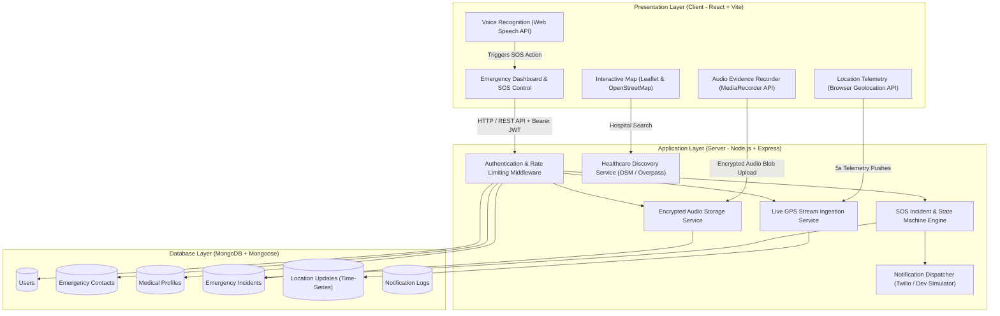
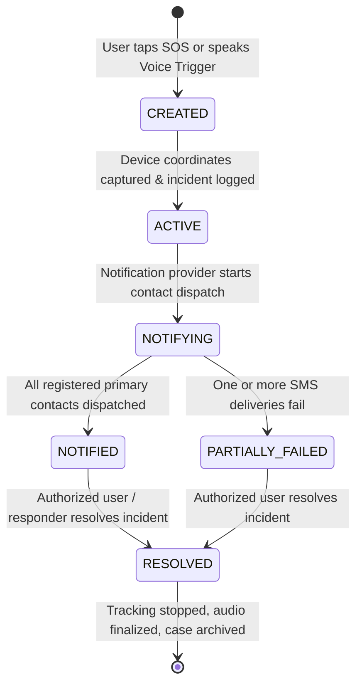

# System Architecture & Technical Specifications
## Clinical Sanctuary (ClinicalGuard) Emergency Alert System

---

## 1. High-Level Architecture Overview

Clinical Sanctuary follows a modern three-tier decoupled client-server architecture designed for high availability, low latency, and graceful degradation in critical emergencies.



---

## 2. Emergency Incident State Machine

The lifecycle of an emergency alert follows a strictly defined, idempotent finite-state machine to prevent race conditions and duplicate dispatches.



### State Definitions
- **`CREATED`**: Incident initialized in database with initial timestamp and user reference.
- **`ACTIVE`**: Incident confirmed; client begins streaming coordinates every 5 seconds; audio recorder engages if consent was granted.
- **`NOTIFYING`**: System invokes notification service (Twilio SMS / In-App) for all configured emergency contacts.
- **`NOTIFIED`**: SMS payloads successfully handed to delivery network or simulated successfully.
- **`PARTIALLY_FAILED`**: At least one contact notification failed; flagged for review while keeping live tracking operational.
- **`RESOLVED`**: Emergency terminated by authenticated user or safety responder. GPS streaming loop terminates, audio upload finalizes, and incident is archived.

---

## 3. Database Schema Design (MongoDB / Mongoose)

### 3.1 User Collection (`users`)
```json
{
  "_id": "ObjectId",
  "name": "Aditya Chourasiya",
  "email": "user@example.com",
  "passwordHash": "$2a$12$...",
  "googleId": "104928374...",
  "avatar": "https://...",
  "role": "USER", // "USER" | "RESPONDER" | "ADMIN"
  "createdAt": "ISODate",
  "updatedAt": "ISODate"
}
```

### 3.2 Emergency Contacts Collection (`emergency_contacts`)
```json
{
  "_id": "ObjectId",
  "userId": "ObjectId (ref: User)",
  "name": "Jane Doe",
  "phone": "+919876543210",
  "relationship": "Mother", // "Parent" | "Spouse" | "Sibling" | "Friend" | "Other"
  "isPrimary": true,
  "email": "contact@example.com",
  "createdAt": "ISODate"
}
```

### 3.3 Medical Profile Collection (`medical_profiles`)
```json
{
  "_id": "ObjectId",
  "userId": "ObjectId (ref: User, unique)",
  "bloodGroup": "O+", // "A+", "A-", "B+", "B-", "AB+", "AB-", "O+", "O-"
  "allergies": ["Penicillin", "Sulfa drugs", "Pollen"],
  "medicalConditions": ["Asthma", "Hypertension"],
  "medications": ["Salbutamol Inhaler", "Amlodipine 5mg"],
  "emergencyNotes": "Carries rescue inhaler in backpack side pocket.",
  "voiceConsentGranted": true,
  "shareWithResponders": true,
  "updatedAt": "ISODate"
}
```

### 3.4 Emergency Incidents Collection (`emergency_incidents`)
```json
{
  "_id": "ObjectId",
  "incidentCode": "CS-20261021-9841",
  "userId": "ObjectId (ref: User)",
  "category": "MEDICAL", // "MEDICAL" | "ACCIDENT" | "FIRE" | "CRIME"
  "status": "ACTIVE", // "CREATED" | "ACTIVE" | "NOTIFYING" | "NOTIFIED" | "PARTIALLY_FAILED" | "RESOLVED"
  "triggerType": "MANUAL", // "MANUAL" | "VOICE"
  "initialLocation": {
    "latitude": 26.2183,
    "longitude": 78.1828,
    "accuracy": 12.5,
    "address": "MITS Campus, Gwalior, MP, India"
  },
  "audioEvidence": {
    "fileUrl": "/uploads/audio/panic-1718920192.webm",
    "duration": 42.5,
    "encryption": "AES-256",
    "recordedAt": "ISODate"
  },
  "resolvedAt": null,
  "resolvedBy": null,
  "createdAt": "ISODate",
  "updatedAt": "ISODate"
}
```

### 3.5 Location Updates Collection (`location_updates`)
*Dedicated scalable collection to avoid document size explosion during continuous 5-second streaming.*
```json
{
  "_id": "ObjectId",
  "incidentId": "ObjectId (ref: EmergencyIncident, indexed)",
  "userId": "ObjectId (ref: User)",
  "latitude": 26.2185,
  "longitude": 78.1830,
  "accuracy": 8.2,
  "speed": 1.4,
  "heading": 120.0,
  "timestamp": "ISODate"
}
```

### 3.6 Notification Logs Collection (`notification_logs`)
```json
{
  "_id": "ObjectId",
  "incidentId": "ObjectId (ref: EmergencyIncident, indexed)",
  "contactId": "ObjectId (ref: EmergencyContact)",
  "contactName": "Jane Doe",
  "recipientPhone": "+919876543210",
  "channel": "SMS",
  "provider": "TWILIO", // "TWILIO" | "DEV_SIMULATOR"
  "status": "SENT", // "SENT" | "SIMULATED" | "FAILED"
  "messageSid": "SMxxxxxxx",
  "error": null,
  "dispatchedAt": "ISODate"
}
```

---

## 4. Security Architecture

1. **Token Verification**: Google OAuth 2.0 ID tokens sent by the client are strictly verified against Google's public keys via `google-auth-library` `verifyIdToken()`. Client-side payload claims are never trusted directly.
2. **Session Protection**: JWTs are signed with a strong secret and passed via Authorization headers or secure HTTP-only cookies.
3. **Password Security**: Passwords are hashed with `bcryptjs` using a minimum salt work factor of 12.
4. **Data Isolation**: All resource controllers verify that `req.user._id` matches the document owner, forbidding cross-tenant data tampering.
5. **Rate Limiting**: Auth endpoints and SOS trigger endpoints are protected by `express-rate-limit` to prevent brute force and denial of service.
6. **HTTP Hardening**: Helmet sets security headers (X-Content-Type-Options, Frameguard, Referrer-Policy, Strict-Transport-Security).
7. **Storage Privacy**: Audio evidence files uploaded to the server are validated by MIME type (`audio/webm`, `audio/mp4`, `audio/ogg`, `audio/wav`), restricted in maximum file size (25MB), and accessible only by the incident owner or emergency responders.
