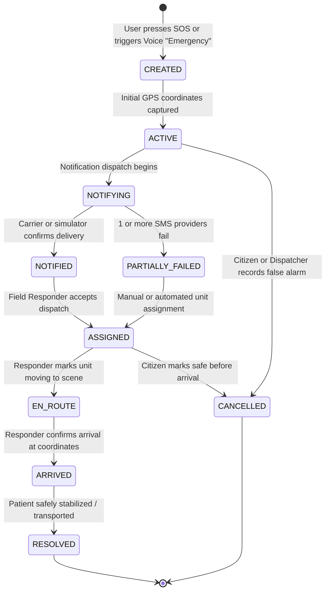

# System Architecture & Technical Specifications
## Clinical Sanctuary (ClinicalGuard) — Next-Generation Emergency Assistance Platform
**Tagline:** Precision in every Response  
**Date:** October 26, 2026

---

## 1. High-Level Architecture Overview

Clinical Sanctuary follows a modern three-tier decoupled client-server architecture designed for high availability, low latency, and graceful degradation during critical emergency scenarios.

```mermaid
flowchart TD
    subgraph Client["Presentation Layer (Client - React 18 + Vite)"]
        UI["Citizen SOS Control & Dashboard"]
        Voice["Voice Recognition (Web Speech API)"]
        AudioRec["Audio Evidence Recorder (MediaRecorder API)"]
        GPS["Location Telemetry (Browser Geolocation API)"]
        Map["Emergency Map Radar (Leaflet & OpenStreetMap)"]
        ResponderUI["Responder Duty Desk & Tactical Status"]
        DispatchUI["Dispatcher Operational Queue & Unit Triage"]
    end

    subgraph Server["Application Layer (Server - Node.js v24 + Express)"]
        AuthMiddleware["Authentication & Role Authorization Middleware"]
        SOSController["SOS Incident & State Machine Engine"]
        LocController["Live GPS Telemetry Ingestion"]
        AudioController["Protected Audio Evidence Storage"]
        ResponderController["Responder Discovery & Assignment Engine"]
        DispatchController["Central Queue & Triage Operations"]
        NotifyService["Notification Dispatcher (Twilio / Dev Simulator)"]
        HospitalService["Healthcare Discovery Service (OSM / Overpass)"]
    end

    subgraph Database["Database Layer (MongoDB + Mongoose)"]
        UserCol[("Users (Citizen, Responder, Dispatcher)")]
        ContactCol[("Emergency Contacts")]
        MedCol[("Medical Profiles")]
        IncCol[("Emergency Incidents")]
        LocCol[("Location Updates (Time-Series)")]
        LogCol[("Notification Logs")]
        RespCol[("Responder Profiles")]
        AssignCol[("Incident Assignments")]
        EventCol[("Incident Event Audit Trail")]
    end

    UI -->|"REST API + Bearer JWT"| AuthMiddleware
    ResponderUI -->|"Tactical API"| AuthMiddleware
    DispatchUI -->|"Operations API"| AuthMiddleware
    GPS -->|"5s Telemetry Pushes"| LocController
    AudioRec -->|"Encrypted Audio Blob Upload"| AudioController

    AuthMiddleware --> SOSController
    AuthMiddleware --> ResponderController
    AuthMiddleware --> DispatchController
    AuthMiddleware --> LocController
    AuthMiddleware --> AudioController

    SOSController --> NotifyService
    SOSController --> IncCol
    SOSController --> EventCol
    ResponderController --> RespCol
    ResponderController --> AssignCol
    DispatchController --> IncCol
```

---

## 2. Emergency Incident State Machine (Uber-Inspired Lifecycle)

The incident lifecycle models an automated, truthful state progression. Statuses cannot be skipped or fabricated without valid evidence or authenticated actions.

### State Definitions
1. **CREATED:** Incident code generated (`CS-YYYYMMDD-XXXX`), database record created with high urgency.
2. **ACTIVE:** Initial location validated; 5-second continuous GPS streaming begins.
3. **NOTIFYING:** Emergency contacts retrieved and notification dispatch initiated.
4. **NOTIFIED:** All contacts contacted through carrier SMS or development simulation.
5. **PARTIALLY_FAILED:** At least one carrier SMS returned an error or timeout; system maintains active alert and logs failure.
6. **ASSIGNED:** An authorized, verified on-duty responder has accepted dispatch.
7. **EN_ROUTE:** Responder is actively navigating toward patient coordinates with live ETA.
8. **ARRIVED:** Responder has arrived at the patient's coordinates.
9. **RESOLVED:** Emergency concluded; patient stabilized. Live GPS streaming terminates.
10. **CANCELLED:** False alarm or user accidental trigger cancelled with reason logged to immutable audit history.

---

## 3. The Three User Journeys & Operational Roles

| Role | Interface | Key Capabilities |
|---|---|---|
| **Citizen (`USER`)** | Emergency Dashboard (`/dashboard`) | 1-touch SOS, voice "Emergency" trigger, consent-based audio recording, contact manager, medical card, live tracking link, official emergency hotline direct dial (112, 108, 100). |
| **Field Responder (`RESPONDER`)** | Responder Desk (`/responder`) | On-duty availability toggle, incident discovery queue, accept/decline dispatches, status transitions (`EN_ROUTE`, `ARRIVED`, `RESOLVED`), patient medical summary access (if consented). |
| **Central Dispatcher (`DISPATCHER` / `ADMIN`)** | Dispatch Control Room (`/dispatch`) | Multi-agency incident triage, category/urgency filters, manual responder dispatch, fleet status overview, audit event log review. |

---

## 4. Database Architecture & Collections

### Core Models:
- **`User`**: Identity, hashed credentials, Google sub ID, role (`USER`, `RESPONDER`, `DISPATCHER`, `ADMIN`).
- **`EmergencyIncident`**: Unique incident code, status state machine, coordinates, category, urgency, cancellation reason.
- **`EmergencyContact`**: Trusted recipients, phone numbers, relationship, primary priority flag.
- **`MedicalProfile`**: Blood group, allergies, chronic conditions, emergency notes, voice consent token, responder sharing toggle.
- **`LocationUpdate`**: High-frequency coordinate stream during active emergency, compound index `{ incidentId: 1, timestamp: 1 }`.
- **`NotificationLog`**: Delivery records, carrier message SIDs, error details, status (`SENT`, `SIMULATED`, `FAILED`).
- **`ResponderProfile`**: Badge number, organization, vehicle type (Ambulance, Patrol Car), availability flag, current location.
- **`IncidentAssignment`**: Lifecycle assignment records between responders and incidents.
- **`IncidentEvent`**: Chronological immutable audit trail of every system action and status transition.

---

## 5. Security & Privacy Safeguards
1. **Truth in Delivery:** Notifications are marked `SIMULATED` unless authenticated by an upstream Twilio API response.
2. **Audio Evidence Access:** Private audio files are not exposed via open directories; served strictly through authenticated endpoint `GET /api/incidents/:id/audio`.
3. **Medical Privacy:** Patient consent (`shareWithResponders`) is checked before transmitting health data to responders.
4. **Official Fallback:** Clear disclaimers explain that Clinical Sanctuary is a supplementary communication system and not a substitute for national emergency numbers (112, 100, 108).
