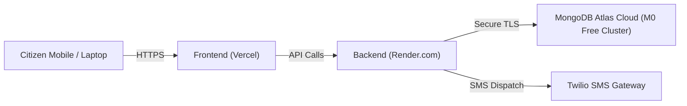

# Production Deployment Guide
## Clinical Sanctuary (ClinicalGuard) — Emergency Alert & Response Platform

---

## 1. Architecture Strategy for Public Hosting

To make the platform accessible to mobile phones and remote laptops anywhere on the internet:



---

## 2. Step 1: Database Migration to MongoDB Atlas (Free Cloud Tier)

1. Sign up free at **[https://cloud.mongodb.com](https://cloud.mongodb.com)**.
2. Create an **M0 (Free)** cluster (choose any region, e.g. AWS Mumbai or Singapore).
3. Under **Security → Database Access**, create a user (e.g. `sanctuary_admin` with a strong password).
4. Under **Security → Network Access**, add IP `0.0.0.0/0` (Allow Access from Anywhere).
5. Click **Connect → Drivers → Node.js** and copy your connection string:
   ```env
   MONGODB_URI=mongodb+srv://sanctuary_admin:<password>@cluster0.xxxxx.mongodb.net/emergency_alert_system?retryWrites=true&w=majority
   ```
6. Run database seed once against Atlas:
   ```powershell
   cd server
   $env:MONGODB_URI="mongodb+srv://..."
   npm.cmd run seed
   ```

---

## 3. Step 2: Backend Deployment on Render.com (Free)

1. Sign up at **[https://render.com](https://render.com)** and connect your GitHub repository:
   `https://github.com/adityachourasiya30-ship-it/clinical-sanctuary`
2. Create a new **Web Service**:
   - **Root Directory:** `server`
   - **Build Command:** `npm install`
   - **Start Command:** `node src/server.js`
   - **Environment Variables:**
     - `NODE_ENV`: `production`
     - `PORT`: `5000` (or leave default, Render sets `PORT` automatically)
     - `MONGODB_URI`: `<Your MongoDB Atlas Connection String>`
     - `JWT_SECRET`: `<64-character random hex string>`
     - `CLIENT_URL`: `https://your-frontend.vercel.app`
3. Click **Deploy Web Service** and note your public URL:
   `https://clinical-sanctuary-backend.onrender.com`

---

## 4. Step 3: Frontend Deployment on Vercel (Free)

1. Sign up at **[https://vercel.com](https://vercel.com)**.
2. Click **Add New → Project** and import:
   `https://github.com/adityachourasiya30-ship-it/clinical-sanctuary`
3. In Project Settings:
   - **Framework Preset:** Vite
   - **Root Directory:** `client`
   - **Build Command:** `npm run build`
   - **Output Directory:** `dist`
4. In `client/vite.config.js`, update proxy or configure `VITE_API_URL` to point to `https://clinical-sanctuary-backend.onrender.com/api`.
5. Deploy. Your public HTTPS application is live!

---

## 5. Step 4: Google Cloud OAuth 2.0 Production Verification

1. Go to **[https://console.cloud.google.com](https://console.cloud.google.com)**.
2. Select your project → **APIs & Services → Credentials**.
3. Edit your OAuth 2.0 Web Client:
   - **Authorized JavaScript Origins:**
     - `http://localhost:5173`
     - `https://your-app.vercel.app`
   - **Authorized Redirect URIs:**
     - `https://your-app.vercel.app`
4. Copy `Client ID` into Render and Vercel environment variables.
